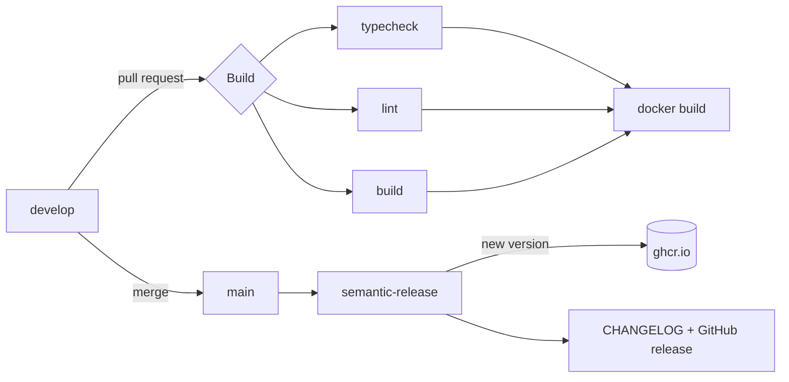

<div align="center">

# ⚡ apps

**One repo, many small apps.**<br />
The foundation behind everything that lives at [apps.nikho.dev](https://apps.nikho.dev).

<br />

[](../../actions/workflows/build.yml)
[](../../releases)
[](../../pkgs/container/apps)


</div>

<br />

## ✨ The idea

Every small app I build is **a route** of this single [TanStack Start](https://tanstack.com/start) project.

They all share the same tooling, i18n, styling, CI and Docker image, so shipping a new idea means writing a route, not bootstrapping yet another repository.

```text
apps.nikho.dev/            →  home
apps.nikho.dev/my-app      →  an app, in English
apps.nikho.dev/fr/my-app   →  the same app, in French
```

## 🚀 Quick start

```bash
bun install
bun run dev        # http://localhost:3000
```

<details>
<summary><b>All scripts</b></summary>

<br />

| Script | What it does |
| --- | --- |
| `bun run dev` | Start the dev server |
| `bun run build` | Production build into `.output/` |
| `bun run preview` | Preview the production build |
| `bun run typecheck` | Type-check with `tsc` |
| `bun run check` | Lint and format check with Biome |
| `bun run generate-routes` | Regenerate the route tree |

</details>

## 🧩 Adding an app

**1. Create a route**

```tsx
// src/routes/my-app.tsx
import { createFileRoute } from "@tanstack/react-router";
import { m } from "#/paraglide/messages";

export const Route = createFileRoute("/my-app")({ component: MyApp });

function MyApp() {
	return <h1>{m.my_app_title()}</h1>;
}
```

**2. Add its strings**

```jsonc
// messages/en.json
{ "my_app_title": "My app" }

// messages/fr.json
{ "my_app_title": "Mon app" }
```

**3. Done.** The route tree regenerates on its own and the app is live at `/my-app` and `/fr/my-app`.

## 🌍 Internationalization

English is the default and has **no URL prefix**. French lives under `/fr/`.

| URL | Locale |
| --- | --- |
| `/` | 🇬🇧 English |
| `/fr/` | 🇫🇷 French |

Powered by [Paraglide JS](https://inlang.com/m/gerre34r/library-inlang-paraglideJs): type-safe messages, tree-shaken per page, no runtime overhead.

<details>
<summary><b>How it is wired</b></summary>

<br />

- Locales are declared in `project.inlang/settings.json`
- Messages live in `messages/{locale}.json`
- `src/paraglide/` is generated by the Vite plugin
- `src/router.tsx` rewrites URLs in and out of the router
- `src/server.ts` resolves the locale from each request

</details>

## 🐳 Docker

```bash
docker build -t apps .
docker run --rm -p 3000:3000 apps
```

Multi-stage build on `oven/bun:slim`. The final image ships only the Nitro bundle (~176 MB), runs as the unprivileged `bun` user and is published for `amd64` and `arm64`.

## 🔁 CI/CD



- **Work on `develop`.** Every push and pull request runs type-check, lint and build in parallel, then a Docker build.
- **Merge into `main` to ship.** [semantic-release](https://semantic-release.gitbook.io) reads the [Conventional Commits](https://www.conventionalcommits.org), bumps the version, updates `CHANGELOG.md`, creates the GitHub release and pushes the image to `ghcr.io` with the `x.y.z`, `x.y` and `latest` tags.

| Commit | Release |
| --- | --- |
| `feat:` | minor |
| `fix:` `perf:` `refactor:` `revert:` | patch |
| `feat!:` or `BREAKING CHANGE` | major |

<br />

<div align="center">

Built by [nikho](https://nikho.dev)

</div>
